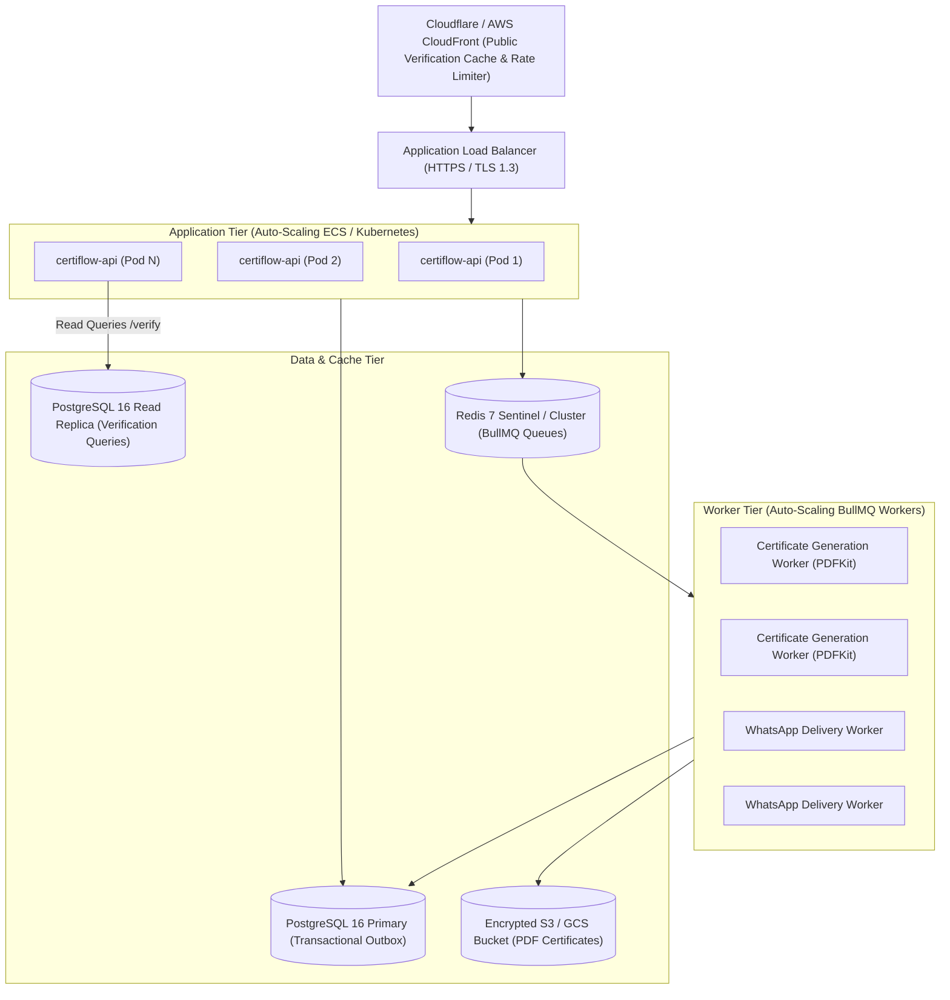

# CertiFlow — Production Deployment & Scaling Architecture

This document describes the production architecture, scaling strategies, resilience mechanisms, and monitoring for deploying CertiFlow at state scale.

---

## 1. Production Architecture Overview

At scale (8,000+ candidates/month, 500 batches/hour peak, 30,000 certificates/hour during graduation windows), CertiFlow runs as a containerized modular monolith with dedicated background worker pools and high-availability PostgreSQL and Redis.



---

## 2. Docker Compose Deployment

The root `docker-compose.yml` provides a production-structured multi-container stack:

```bash
docker compose up --build -d
```

### Managed Services:
1. **`postgres`**: PostgreSQL 16 on port `5432` with healthcheck and persistent volume `postgres_data`.
2. **`redis`**: Redis 7 on port `6379` with healthcheck and persistent volume `redis_data`.
3. **`backend`**: Production Express API running on port `5000` with migration checks and Prisma client.
4. **`worker`**: Dedicated BullMQ worker container listening to `certificate-generation` and `whatsapp-delivery`.
5. **`frontend`**: Nginx container serving optimized static React bundle on port `3000` and reverse-proxying `/api` and `/uploads`.

---

## 3. High-Load Scaling Strategies (500 Batches / Hour)

### 1. Database Connection Pooling & Read Replicas
- Configure `PgBouncer` with transaction pooling (default pool size: 50 connections).
- Public verification endpoint (`/api/verify/:certificateId`) accounts for 75% of read traffic. Point all public verify requests to read replicas with a 60-second Redis cache layer.

### 2. BullMQ Worker Concurrency & Partitioning
- Separate PDF generation workers from message delivery workers:
  - `certificate-generation`: High CPU (PDF rendering). Scale horizontally across compute-optimized nodes (`c6g.xlarge` / `4 vCPU`).
  - `whatsapp-delivery`: High I/O (HTTP requests to WhatsApp Business API). Scale with high concurrency (`concurrency: 50`).

### 3. Idempotency & Rate Limiting
- Unique constraints `@@unique([batchId, candidateId])` and `@@unique([certificateNumber])` prevent duplicate issuance under concurrent API calls.
- Redis-based rate limiting on `/api/batches/:id/upload` (max 10 uploads per minute per training centre) to prevent memory exhaustion from oversized spreadsheets.

---

## 4. Disaster Recovery & Data Integrity

| Layer | Recovery Policy | RPO / RTO |
|---|---|---|
| **Database** | Continuous WAL archiving to S3 + daily full snapshots | RPO: < 5 minutes, RTO: < 30 minutes |
| **Certificates** | Immutable S3 bucket with Object Lock and Versioning | RPO: 0 (Cryptographically hashed) |
| **Audit Logs** | Append-only database table; replicated to external SIEM / AWS CloudWatch | RPO: Real-time |
| **Queue Messages** | Redis AOF (Append-Only File) enabled (`appendfsync everysec`) | RPO: < 1 second |

---

## 5. Security & Compliance Checklist

- [x] **Zero Frontend Reliance**: Role authorization (`TRAINING_CENTRE`, `DISTRICT_OFFICER`, `QUALITY_TEAM`, `STATE_OFFICE`) enforced strictly via backend middleware (`requireRole`).
- [x] **Bcrypt Password Hashing**: Cost factor 10.
- [x] **Stateless JWT**: Signed with `RS256` or secure HMAC secret, expiration 7 days.
- [x] **Zero Auth Leakage on Public Verification**: `/verify/:id` returns only candidate name, course, training centre, completion date, and status. No phone numbers or personally identifiable contact info exposed.
- [x] **Tamper Detection**: Every certificate contains a deterministic SHA-256 hash computed over `certificateNumber|candidateName|courseCode|trainingCentre|completionDate|authority`. Any document modification invalidates the cryptographic verification.

