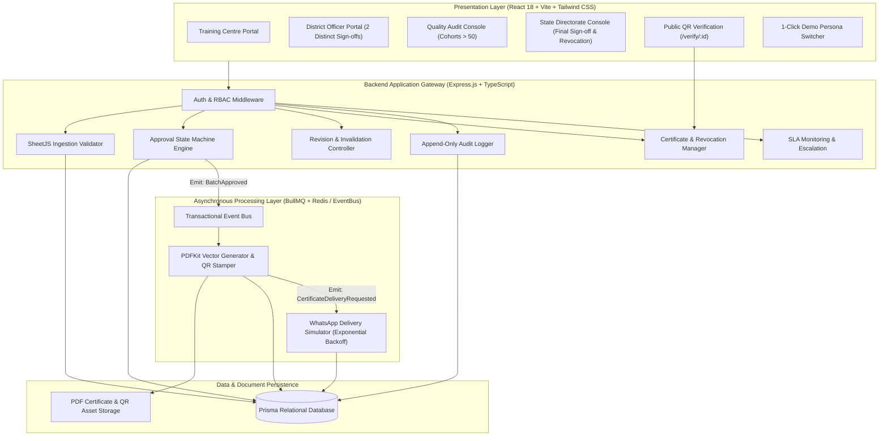

# CertiFlow — Skilling Certificate Issuance & Verification Platform

[-emerald.svg)](backend/tests/criticalScenarios.test.ts)
[](backend)
[](frontend)
[](backend/prisma)
[](#2-how-the-system-is-put-together)

---

## 1. Requirements Note & Problem Statement

### Background & Context
CertiFlow is designed to replace the fragile manual certificate issuance process of a state vocational skilling initiative:
- **Current Bottlenecks**: Training centres manually email spreadsheets of passed students; district officers review through informal channels; state offices grant sign-offs without version history; clerks manually issue certificates; delivery is lost in spam; employers have no tamper-proof mechanism to verify authenticity.
- **Consequences**: Certificate fraud, data-entry discrepancies, duplicate issuances, absence of an immutable audit trail, and zero verification trust for prospective employers.

### Target Operational Scale
- **8,000+ candidates per month** across **300+ training centres**.
- **100,000 registered users** with **10,000 daily active users**.
- **Peak processing**: Up to **500 batches per hour** and **30,000 certificates/delivery messages** during major state graduation cycles.

### Functional Requirements Checklist
- [x] **Role-Based Access Control**: Training Centre, District Officer, Quality Team, State Office, and Public/Employer.
- [x] **Spreadsheet Ingestion & Atomic Validation**: SheetJS engine parsing candidate rosters with pre-validation of phone format, marks (0–100), pass/fail criteria, duplicate candidates, and atomic rollback (zero partial rows saved on failure).
- [x] **Multi-Tier Approval State Machine**: Training Centre ➔ Two Distinct District Officers ➔ Quality Team Review (automated for cohorts > 50) ➔ State Office Final Approval.
- [x] **Revision Invalidation Rule**: Returning a batch increments the revision number, archives previous approvals as superseded, and strictly requires fresh multi-tier approvals.
- [x] **Automated Vector PDF Certificate Generation**: Server-side PDFKit generator with official guilloche borders, security seals, dynamic QR codes, and SHA-256 integrity hashes.
- [x] **Simulated WhatsApp Delivery & Backoff**: Background worker with exponential backoff (2s, 4s, 8s), diagnostic failure handling, and manual retry.
- [x] **Public Verification (Zero Authentication)**: `/verify/:certificateId` displaying real-time credential status (`VALID`, `CANCELLED`, or `NOT_FOUND`).
- [x] **State Certificate Revocation**: State official cancellation with mandatory justification logging.
- [x] **Append-Only Immutable Audit Trail**: Complete action history across all entities and revisions.
- [x] **SLA Escalation Monitoring**: Overdue batch detection against configurable stage durations (District 24h, Quality 12h, State 24h).

---

## 2. How the System is Put Together

CertiFlow is engineered as an **Event-Driven Modular Monolith** with decoupled asynchronous workers, providing enterprise reliability without microservice overhead.



### Module Responsibilities:
1. **Frontend (`frontend/`)**: React 18, Vite, TypeScript, Tailwind CSS, Lucide icons, React Router v6, Axios. Features an instant **1-Click Demo Switcher** banner, allowing evaluators to jump between all 6 roles without re-logging in.
2. **Backend API (`backend/src/modules/`)**: Express with clean separation of concerns:
   - `auth/`: JWT authentication, bcrypt hashing, demo credentials endpoint.
   - `batches/`: Batch lifecycle CRUD, candidate roster management, revision tracking.
   - `approvals/`: Enforces two distinct district officer approvals and optimistic concurrency locks.
   - `quality/`: Quality review queue, anomaly inspection, and candidate-level flagging.
   - `state/`: State final authorization, platform analytics, certificate revocation.
   - `certificates/`: PDF downloads, QR retrieval, SHA-256 hash validation.
   - `verification/`: Public `/api/verify/:certificateId` requiring **zero login**.
   - `delivery/`: WhatsApp simulator queue, status monitoring, and manual retry.
   - `audit/`: Append-only governance ledger recording every transition.
   - `sla/`: Stage elapsed time tracking and escalation flags.
3. **Workers (`backend/src/workers/`)**:
   - `certificateWorker`: Decouples HTTP responses from PDF rendering.
   - `whatsappSimulator`: Simulates real-world network conditions (success, timeouts, temporary rate limits, permanent invalid numbers).
4. **Database (`backend/prisma/`)**: Normalized schema covering `User`, `District`, `TrainingCentre`, `Batch`, `Candidate`, `BatchCandidate`, `Approval`, `Certificate`, `DeliveryJob`, `AuditLog`, `SlaConfig`.

---

## 3. Key Technical Decisions & Architectural Rationales

| Decision | Alternative Considered | Technical Reason / Rationale |
|---|---|---|
| **Modular Monolith Architecture** | Microservices (Auth, Batch, Delivery as separate services) | Avoids distributed transaction failures, network latency, and orchestration overhead. Keeps batch state transitions atomic via database transactions while decoupling heavy CPU (PDF rendering) and I/O (WhatsApp delivery) through background workers. |
| **Dual Database Configuration (PostgreSQL / SQLite)** | PostgreSQL only | PostgreSQL is used in Docker/Production (`schema.postgresql.prisma`). A synchronized SQLite configuration (`schema.prisma`) allows local zero-setup execution, unit testing, and teammate cloning without requiring an external database service. |
| **Atomic In-Memory Spreadsheet Pre-Validation** | Streaming row-by-row insertion | Candidate spreadsheets must either completely succeed or completely fail. In-memory validation with SheetJS verifies headers, 10-digit mobile standards, and passing criteria before writing to the database, guaranteeing **zero corrupted or half-imported batches**. |
| **Strict Revision Invalidation Model** | Retaining old approvals on data edit | If candidate data is returned and corrected, historical approvals cannot be trusted. Incrementing `currentRevision` and flagging old approvals `isSuperseded: true` preserves audit history while requiring fresh multi-tier approvals. |
| **Unique Constraint Concurrency Guard (`batchId, revision, officerId`)** | Application-level locking | To prevent race conditions where two district officers approve simultaneously, a composite unique constraint at the database layer guarantees an officer can only record one approval per revision, and exactly two distinct officers are recorded. |
| **Deterministic SHA-256 Certificate Hash** | Unsigned PDF / Non-hashed certificate | Every certificate includes a cryptographic SHA-256 hash over `certificateNumber|candidateName|courseCode|trainingCentre|completionDate|authority`. Tampering with any field invalidates the credential. |

---

## 4. Quick Start & Execution

### Option A: Local Run (Instant Zero-Setup)
```bash
# 1. Start Backend API & Background Workers
cd backend
npm run dev

# 2. In a second terminal, start Frontend
cd frontend
npm run dev
```
Open **[http://localhost:3000](http://localhost:3000)** in your browser.

### Option B: Docker Compose
```bash
docker compose up --build
```
Open **[http://localhost:3000](http://localhost:3000)** in your browser.

---

## 5. Automated Tests

Run the full integration test suite covering all 8 core invariant tests:

```bash
cd backend
npm test
```

```
 ✓ tests/criticalScenarios.test.ts (8 tests)
   ✓ Test 1: Spreadsheet validation fails on invalid rows and saves ZERO partial data
   ✓ Test 2: Same officer cannot approve the same batch revision twice
   ✓ Test 3: Second distinct officer approval advances batch to next review stage
   ✓ Test 4: State approval triggers certificate generation for all passing candidates
   ✓ Test 5: WhatsApp delivery simulator handles failure and retry mechanism
   ✓ Test 6: Revoked certificate cannot be shown as valid on public verification
   ✓ Test 7: Returning a batch increments revision and invalidates prior approvals
   ✓ Test 8: Unauthorized roles are rejected by backend RBAC middleware
```

---

## 6. Pre-Seeded Demo Personas

| Name | Role | Email | Password |
|---|---|---|---|
| **Anika Sharma** | Training Centre Lead | `anika@skilling.gov.in` | `Demo@123` |
| **Dev Malhotra** | District Officer 1 | `dev@district.gov.in` | `Demo@123` |
| **Meera Iyer** | District Officer 2 (Senior) | `meera@district.gov.in` | `Demo@123` |
| **Kabir Sengupta** | District Officer 3 | `kabir@district.gov.in` | `Demo@123` |
| **Neha Kapoor** | Quality Team Lead | `neha@quality.gov.in` | `Demo@123` |
| **Farah Siddiqui** | State Directorate Officer | `farah@state.gov.in` | `Demo@123` |
| **Public Verifier** | Employer / Public | `/verify/CERT-2026-800001` | *No Login* |

---

## 7. Additional Documentation Links
- **[SETUP.md](file:///e:/OneDrive/Desktop/Algohire%20Antigrav/SETUP.md)** — Step-by-step fresh clone guide & walkthrough.
- **[DEPLOYMENT.md](file:///e:/OneDrive/Desktop/Algohire%20Antigrav/DEPLOYMENT.md)** — Production deployment, scaling plan (500 batches/hr), and disaster recovery.
